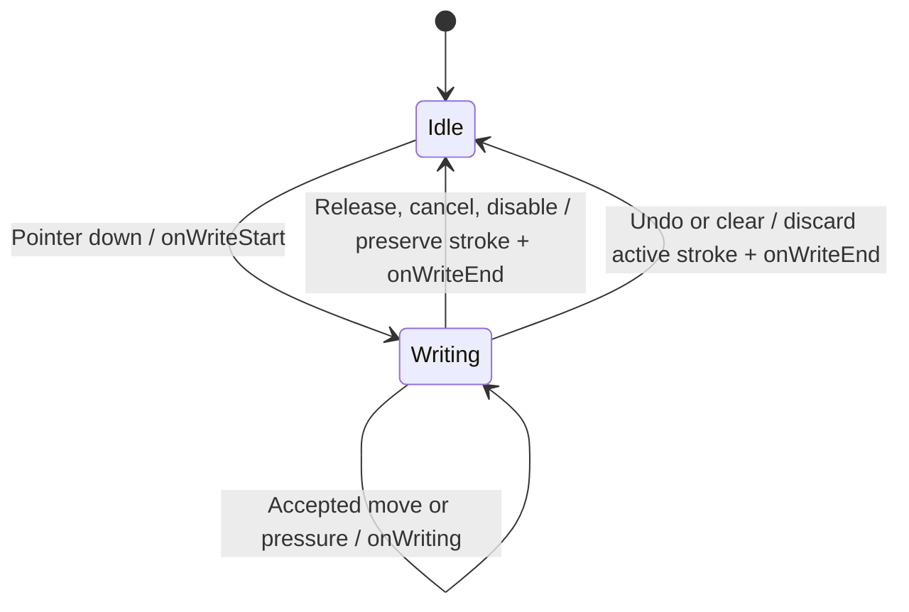

# SignKit

A Kotlin Android signature pad featuring smooth Bézier strokes, velocity-based pen dynamics, optional pressure input, adjustable stroke width, stroke-by-stroke undo, bitmap export, and writing lifecycle callbacks.

## Features

- Fixed-width, velocity, pressure, and combined pen modes.
- Configurable stroke width and velocity response, with controlled stroke endings.
- Stroke-by-stroke undo, clear, and undo availability checks.
- Bitmap export with transparent or custom backgrounds.
- Writing start, progress, and end callbacks.
- Raw pressure, input tool, and device information.
- Demo app with pen controls and bitmap preview.

Requires Android 11 (API 30) or later. Pressure effects depend on the input values reported by the device.

## Integration

Include the `signkit` module as a project dependency:

```kotlin
implementation(project(":signkit"))
```

Alternatively, download `signkit-1.0.1.aar` from [Releases](https://github.com/x2ink/SignKit/releases/tag/v1.0.1), place it in your app's `libs` directory, and declare its dependencies explicitly:

```kotlin
implementation(files("libs/signkit-1.0.1.aar"))
implementation("androidx.core:core-ktx:1.19.1")
implementation("androidx.appcompat:appcompat:1.8.0")
implementation("com.google.android.material:material:1.14.0")
```

These are alternative integration methods. The SDK requires API 30 or later and is built with compileSdk 37. This release is distributed through GitHub Releases; there is no Maven Central coordinate.

## Quick start

Add the view to your layout. Place it inside a container that gives it a nonzero width and height:

```xml
<ink.x2.signkit.SignPadView
    android:id="@+id/signPad"
    android:layout_width="match_parent"
    android:layout_height="match_parent" />
```

Configure it from your Activity or Fragment after inflating the binding:

```kotlin
import ink.x2.signkit.SignPadView

binding.signPad.apply {
    penMode = SignPadView.PenMode.VELOCITY
    strokeWidth = 24f * resources.displayMetrics.density
}
```

Use the SDK's state-changing and drawing methods on the UI thread. Pen settings are captured at the start of each stroke; changing them affects the next stroke and leaves the current stroke and history unchanged.

## Pen modes and settings

| `SignPadView.PenMode` | Behavior |
| --- | --- |
| `FIXED` | Constant width; the SDK default. Ignores pressure and speed. |
| `VELOCITY` | Faster motion produces thinner strokes. Recommended for finger input; the demo default. |
| `PRESSURE` | Device pressure maps linearly to width; pressure can change width without movement. |
| `PRESSURE_AND_VELOCITY` | Combines the pressure and velocity target widths. |

| Property | Default | Meaning and accepted values |
| --- | --- | --- |
| `penMode` | `FIXED` | One of the modes above. |
| `strokeWidth: Float` | `5 × density` | Width in **pixels**; maximum width in dynamic modes. Must be finite and greater than zero. |
| `minStrokeWidthRatio: Float` | `3f / 7f` | Dynamic minimum width divided by maximum width; finite and in `(0, 1]`. |
| `velocityFilterWeight: Float` | `0.9f` | Weight of the latest speed sample; finite and in `(0, 1]`. Larger values respond faster. |
| `velocityReference: Float` | `1f / density` | Speed scale in **dp/ms**. Must be finite and greater than zero. Larger values make a given speed produce wider strokes. The default is equivalent to 1px/ms. |

For example, set a 32dp maximum and a minimum of half that width:

```kotlin
binding.signPad.apply {
    penMode = SignPadView.PenMode.VELOCITY
    strokeWidth = 32f * resources.displayMetrics.density
    minStrokeWidthRatio = 0.5f
    velocityFilterWeight = 0.9f
    velocityReference = 1f
}
```

Dynamic minimum width is `strokeWidth * minStrokeWidthRatio`. Velocity and combined modes use that minimum width for stationary contact dots and moving starts, avoiding a large dot that suddenly becomes a thin line. Their rebuilt tail limits growth during a slow lift; width still varies through the stroke body. Pure pressure mode retains pressure-sized dots and stationary pressure changes.

Invalid numeric settings throw `IllegalArgumentException`. Pressure-based effects require changing pressure values from the input device; finger or mouse input may report a constant value. Choose `VELOCITY` when pressure is unavailable.

## Writing lifecycle

Register with `setOnWriteListener()`:

```kotlin
binding.signPad.apply {
    setOnWriteListener(object : SignPadView.OnWriteListener {
        override fun onWriteStart(view: SignPadView) {}
        override fun onWriting(view: SignPadView) {}
        override fun onWriteEnd(view: SignPadView) {}
    })
}
```

| Callback | When it runs |
| --- | --- |
| `onWriteStart(view)` | A new stroke starts; `canUndo` is already true. |
| `onWriting(view)` | A movement or pressure change is accepted by the drawing filter. It is not a callback for every raw input sample. |
| `onWriteEnd(view)` | The stroke finishes or is interrupted; the updated history/state is available to the callback. |

Callbacks run synchronously on the UI thread after the corresponding state update. Normal release, touch cancellation, and disabling the view preserve the current stroke and end writing once. `clear()` or `undo()` during writing also ends the lifecycle, while discarding the active stroke. The pad follows the initial pointer and finishes its stroke when that pointer lifts.

Remove the listener with `binding.signPad.setOnWriteListener(null)`.



## Raw input listener

Use `setOnInputListener()` to inspect unfiltered device input, including historical samples and pressure changes below the drawing distance threshold:

```kotlin
var latestInput: SignPadView.InputInfo? = null
binding.signPad.setOnInputListener { input ->
    latestInput = input
}
```

`InputInfo` contains:

| Field | Meaning |
| --- | --- |
| `pressure: Float` | Raw device pressure. Drawing normalizes it to `[0, 1]`; the listener receives the original value. |
| `toolType: Int` | A `MotionEvent.TOOL_TYPE_*` value, such as finger, stylus, or mouse. |
| `deviceId: Int` | Android input device ID. |
| `isContact: Boolean` | False for release/cancel samples; exclude those samples when measuring contact pressure ranges. |

This listener runs on the UI thread and observes the active pointer. Remove it with `setOnInputListener(null)`. Writing callbacks and raw input callbacks serve different purposes; do not use the raw sample count as the number of drawn points.

## Undo and clear

```kotlin
val hasInkOrActiveStroke: Boolean = binding.signPad.canUndo
val didUndo: Boolean = binding.signPad.undo()
binding.signPad.clear()
```

- `canUndo` is true when a stroke is active or completed history is nonempty.
- `undo(): Boolean` discards the active stroke first, otherwise removes the most recently completed stroke. It returns false when there is nothing to undo.
- `clear()` removes all completed and active strokes, preserving pen settings.

Completed strokes retain their original settings. Redo is not provided.

## Bitmap export

Export after layout, for example from a button click:

```kotlin
import android.graphics.Color

val transparent = binding.signPad.exportBitmap()
val onWhite = binding.signPad.exportBitmap(Color.WHITE)
```

`exportBitmap(backgroundColor: Int = Color.TRANSPARENT): Bitmap` returns a new bitmap with the pad's full pixel dimensions, including the current stroke preview if writing is in progress. It renders signature ink over the supplied color; the view's XML background is not copied. Export does not alter history, advance the stroke, or end writing.

The pad must have a positive width and height; otherwise export throws `IllegalStateException`. The returned bitmap belongs to the caller; save it or show it in an `ImageView` as needed. Automatic cropping, file saving, SVG export, signature import, and automatic stroke-state restoration are not included.

## Development

After cloning, enable the repository's commit hooks:

```sh
./scripts/install-git-hooks.sh
```

Run `git commit` to choose a commit type interactively. A message already written as `feat: ...` or `fix(pen): ...` can be supplied with `-m`. Both paths are validated before committing.

```sh
./gradlew :app:assembleDebug :signkit:testDebugUnitTest
./gradlew :signkit:connectedDebugAndroidTest :app:connectedDebugAndroidTest
```

See [architecture](docs/ARCHITECTURE.md) and [contributing](docs/CONTRIBUTING.md).

## Releases

Download SDK binaries and the demo APK from [GitHub Releases](https://github.com/x2ink/SignKit/releases). Version tags trigger the build and publish workflow; see [releasing](docs/RELEASING.md).

## Acknowledgments

Parts of the dynamic stroke implementation are adapted from [android-signaturepad](https://github.com/gcacace/android-signaturepad), licensed under Apache-2.0. Attribution and the upstream license are included in the library's `META-INF` resources.
