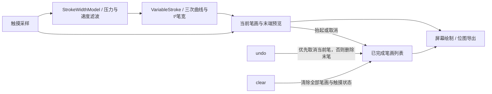

# SignKit 架构

`signkit` 提供 `SignPadView`，`app` 为签名和撤销操作示例。

## 流程

触摸采样经过 2dp 位移过滤，固定模式生成中点二次贝塞尔曲线；完成的笔画按笔保存，配置在按下时锁定。当前笔画补齐末端后绘制，屏幕和位图导出共用入口。书写监听在状态更新后同步通知。

动态模式采用 android-signaturepad 的四点滑窗、距离加权三次控制点，`CubicCurve` 生成曲线，`StrokeWidthModel` 计算速度/压力目标宽度，`VariableStroke` 以t³插值渲染每段。旧平方响应、额外宽度滤波和距离起笔包络已移除。尾段预览使用模型快照，已完成笔画保存实际轮廓。

速度型笔触的最终轮廓还限制笔宽相对路程的增长，并禁止成熟尾段回粗；实际落成的宽度供下一段使用，避免起步与停顿生成突兀大圆。纯压力与固定模式不加此约束。

## 接口与文档

- `SignPadView.undo(): Boolean`：撤销当前笔或最后一笔。
- `SignPadView.canUndo: Boolean`：查询是否可撤销。
- `SignPadView.clear()`：清空签名。
- `SignPadView.exportBitmap(backgroundColor: Int): Bitmap`：导出签名。
- `SignPadView.strokeWidth: Float`：配置后续笔画宽度（px）。
- `SignPadView.setOnWriteListener(listener: OnWriteListener?)`：开始、正在写、结束回调。
- `SignPadView.setOnInputListener(listener: ((InputInfo) -> Unit)?)`：主指原始压力、工具、设备与接触标记。
- `SignPadView.penMode`：固定、速度、压力、压力＋速度模式。
- `SignPadView.minStrokeWidthRatio`、`velocityFilterWeight`：动态最小宽比例与速度滤波权重。
- `SignPadView.velocityReference`：速度尺度（dp/ms，默认1/density，使物理尺度等效上游1px/ms），随笔配置锁定。
- [当前动态笔触规格](spec/reference-brush.md)
- [首尾宽度规则](spec/endpoint-width.md)
- [上游来源与许可](references/signaturepad/README.md)
- [笔宽与响应校准](spec/pen-calibration.md)
- [压力与动态笔锋规格](spec/dynamics.md)
- [动态起笔形状规格](spec/startup-envelope.md)
- [书写与示例规格](spec/writing.md)
- [撤销规格](spec/undo.md)

## Development

- [Contributing and commit hooks](CONTRIBUTING.md)
