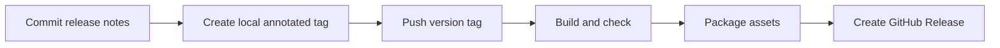

# Releases

Releases are driven by Git tags. The GitHub Actions workflow builds and checks the project, then publishes the AAR, debug demo APK, checksums, and English release notes. The publish job uses GitHub's temporary repository token; no personal access token is required.



1. Add `docs/releases/X.Y.Z.md` and commit it with any release changes.
2. Push the commit to `main`.
3. Create and push the version tag:

```sh
git tag -a vX.Y.Z -m "SignKit vX.Y.Z"
git push origin vX.Y.Z
```

The workflow accepts stable `vX.Y.Z` tags. Build and test failures prevent publication. The `build` job has read-only repository permission; only the separate `publish` job receives `contents: write`.

To package locally after building:

```sh
./gradlew :signkit:assembleRelease :signkit:lintRelease :signkit:testDebugUnitTest :app:assembleDebug :app:testDebugUnitTest
./scripts/package-release.sh vX.Y.Z
```

Assets are written to `build/releases/vX.Y.Z/`, which is ignored by Git. The demo is debug-signed and intended for evaluation. Release publication is separate from Maven Central publication.

## Retry after a workflow fix

Do not move or force-push a version tag. After fixing the workflow on `main`, set `.github/release-request.json` to the existing tag and increment its `request` number, then commit and push. This triggers a fresh run of the updated workflow, which explicitly checks out and builds the original tagged source. The SDK source and tag remain unchanged.

An authenticated CLI can also trigger the workflow's manual `tag` input. SDK initialization is explicit through `android-actions/setup-android`; the workflow does not assume `sdkmanager` is already installed or on the runner's PATH.

The publisher verifies the checked-out commit against the build output and requires an existing remote tag. It intentionally omits `gh release create --target`: GitHub may require workflow-write permission when an explicit historical target differs from the default branch's workflow files, even though the tag already exists. Omitting that unused creation parameter preserves the existing tag and allows the repository-scoped `contents: write` token to publish.
