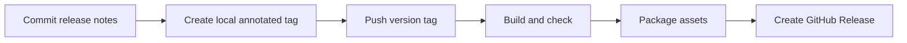

# Releases

Releases are driven by Git tags. The GitHub Actions workflow builds and checks the project, then publishes the AAR, debug demo APK, checksums, and English release notes. The publish job uses GitHub's temporary repository token; no personal access token is required.



1. Add `docs/releases/X.Y.Z.md` and commit it with any release changes.
2. Push the commit to `main`.
3. Create and push the version tag:

```sh
git tag -a vX.Y.Z -m "SignKit vX.Y.Z"
git push origin vX.Y.Z
```

The workflow accepts stable `vX.Y.Z` tags. Build and test failures prevent publication. The `build` job has read-only repository permission; only the separate `publish` job receives `contents: write`.

To package locally after building:

```sh
./gradlew :signkit:assembleRelease :signkit:lintRelease :signkit:testDebugUnitTest :app:assembleDebug :app:testDebugUnitTest
./scripts/package-release.sh vX.Y.Z
```

Assets are written to `build/releases/vX.Y.Z/`, which is ignored by Git. The demo is debug-signed and intended for evaluation. Release publication is separate from Maven Central publication.
