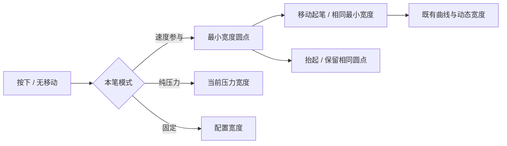

# 接触圆点与起笔宽度

## 问题与规则

2026-11-03真实设备截图：速度模式的独立点约为横线笔身的两倍粗。按下与点按使用最大宽度，移动起笔却使用最小宽度，导致同一次接触的可见宽度突然缩小。

本规则替代 [首尾宽度规则](endpoint-width.md) 中“未移动tap按原逻辑画圆点”的约定，其他曲线与端点规则继续适用。

- `VELOCITY`、`PRESSURE_AND_VELOCITY` 在没有移动速度时，预览、停留及完成点按统一使用本笔的最小宽度，与移动起笔一致；不能先显示大点再替换为细线。
- 开始移动后沿用已有速度/压力目标、t³过渡及几何限增长规则。最小宽度按按下时的配置锁定。
- `PRESSURE` 保留压力决定的点按/原地加压宽度；`FIXED` 使用配置宽度。
- 不新增公共接口；`strokeWidth`、`minStrokeWidthRatio`、生命周期、撤销、清空、实时绘制与位图导出的契约不变。

## 验收

覆盖速度和混合模式、低/高压力、24/64px最大宽度和不同最小比例。按下、原地停留与完成点按的位图一致；与最快横线相比，圆点及首个移动起点的厚度至多相差抗锯齿的2px。纯压力的原地加压仍可增粗，固定模式不随速度变化。完成/取消、撤销、导出及逐笔配置回归通过。
