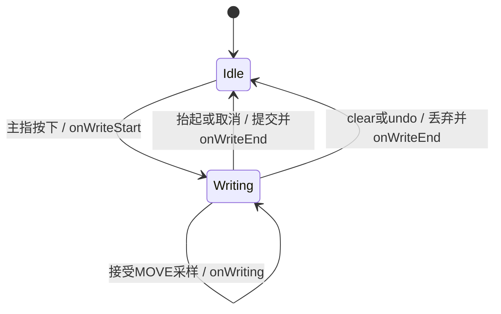

# 平滑书写、画笔粗细与生命周期

## 行为与接口

- 固定模式以中点二次贝塞尔曲线连接已接受的采样点；动态模式见 [当前参考规格](reference-brush.md)，使用三次曲线。距上一接受点不足 2dp 的 MOVE 噪声不加入路径，历史采样按时间处理；抬起位置不受阈值过滤。
- `var strokeWidth: Float` 使用 px，必须为正有限值。默认 5dp；每笔按下时锁定配置，调整不改变历史与当前笔画的配置。动态模式下为最大宽度，见 [动态规格](dynamics.md)。
- `setOnWriteListener(listener: OnWriteListener?)` 注册/替换监听，null 移除。三个方法均提供空实现：`onWriteStart(view)`、`onWriting(view)`、`onWriteEnd(view)`。
- 主指 DOWN 通知开始；一个 MOVE 事件接受新点后至多通知一次正在写；结束前状态复位且导出结果已更新。
- UP、主指 POINTER_UP、CANCEL 各结束一笔。绘制中 clear/undo 也通知结束一次；无活动笔画时不通知。点按只有开始和结束。次指不触发生命周期。
- 回调在 UI 线程同步调用；允许在回调中 clear/undo，不应产生重复结束事件。
- 导出继续复用屏幕的绘制流程，保持所有笔画各自宽度；clear 不改变画笔配置。

## 示例与验收

```kotlin
binding.spvTest.setOnWriteListener(object : SignPadView.OnWriteListener {
    override fun onWriteStart(view: SignPadView) { }
    override fun onWriting(view: SignPadView) { }
    override fun onWriteEnd(view: SignPadView) { }
})
binding.spvTest.strokeWidth = 8f * resources.displayMetrics.density
```



测试 App 提供粗细滑动条（现为 4–64dp、默认 24dp，见 [校准规格](pen-calibration.md)）、撤销、清空、导出 Bitmap，显示三种回调的状态。导出结果显示在页面预览区，标明尺寸，不申请存储权限。

验收覆盖现有撤销回归、生命周期次数与顺序、各结束入口、粗细及历史保留、非法参数、端点和抖动过滤。构建库和示例、运行设备测试与 lint；使用截图检查示例控件与导出预览。
